  

  &nbsp;
  &nbsp;
  

 

I'm an **AI Engineer** with 7+ years of experience shipping products end to end. I design and build LLM-powered systems, from agents and RAG pipelines to MCP integrations and automated workflows, and craft the interfaces that make them a pleasure to use. Computer Science graduate from UFCG.

 

 

<picture>
  <source media="(prefers-color-scheme: dark)" srcset="https://raw.githubusercontent.com/MatheusVBLima/MatheusVBLima/output/github-snake-dark.svg"/>
  
</picture>
